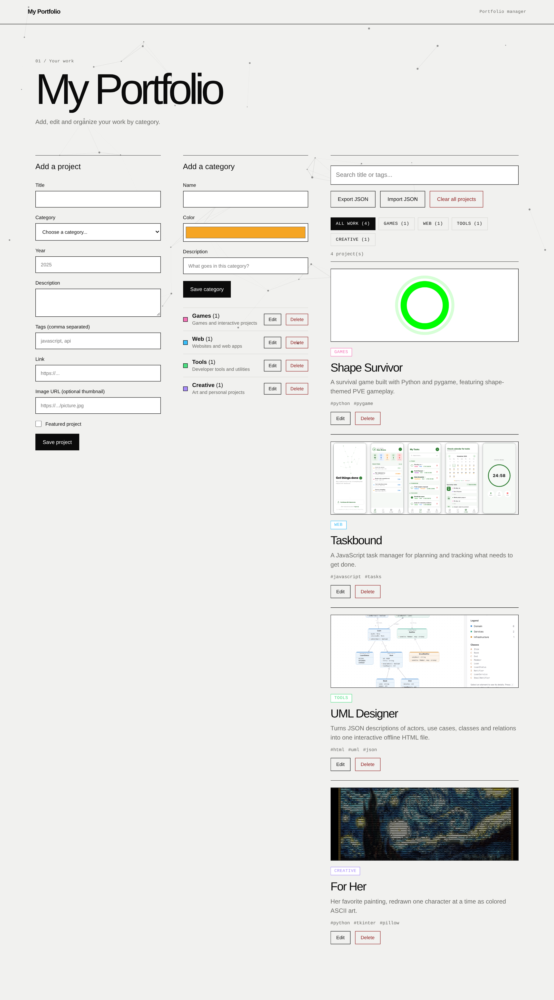

<h1 align="center">My Portfolio</h1>

<p align="center">
  Add, edit and organize your work by category.
</p>

<p align="center">
  
  
  
  
</p>

<p align="center">
  
</p>

> **Note:** this is only the start of my portfolio for this subject. More projects and pages will be added as the course goes on.

A small portfolio manager that runs in the browser. Add projects with a title, year, tags, link and thumbnail, group them by category, then search and filter them. Everything is saved locally with IndexedDB, so no server is needed.

## Quick start

```bash
git clone https://github.com/ritsukasu/portfolio-app.git
cd portfolio-app
```

Then open `index.html` in your browser.

## Project structure

```text
.
├── index.html            # Page layout
├── portfolio-preview-full.png  # Preview used in this README
├── style.css             # Design and animations
├── app.js                # Projects, categories and Dexie database
├── motion.js             # Animated node background
└── portfolio.mongodb.js  # MongoDB version of the data
```

## MongoDB setup (optional)

The web app stores its data in the browser with Dexie and does **not** use MongoDB. `portfolio.mongodb.js` is a separate database lesson: the same project documents, written as MongoDB queries and run from VS Code against a free MongoDB Atlas cluster.

### 1. Set up Atlas

1. Sign in at [cloud.mongodb.com](https://cloud.mongodb.com) and create a free **M0** cluster (for example `Cluster0`).
2. Go to **Database Access > Database Users** and create a user with a simple password (letters and numbers only) and the **Read and write to any database** role.
3. Go to **Network Access > IP Access List** and add your current IP address. Add it again if you change networks.
4. Go to **Clusters > Connect > Drivers** and copy the connection string. It looks like this:

   ```text
   mongodb+srv://<username>:<db_password>@cluster0.xxxxx.mongodb.net/
   ```

   Replace `<db_password>` with your user's password, and remove the angle brackets.

### 2. Connect in VS Code

1. Install the **MongoDB for VS Code** extension.
2. Click the **leaf icon** in the sidebar, then **Add Connection > Connect with Connection String**.
3. Paste your connection string and connect. A green dot next to your cluster means it worked.

> **Keep your connection string private.** It contains your password. Paste it only into the extension, and never into a file in this repo. The extension stores it for you, so `portfolio.mongodb.js` has no credentials in it and is safe to commit.

### 3. Run the playground

1. Open `portfolio.mongodb.js`.
2. Press the **play button** at the top right and pick your connection if asked.
3. To watch each step, select one block (Create, Read, Update or Delete), right-click and choose **Run Selected Lines From Playground**.
4. Refresh the connection in the sidebar to see `portfolio > projects`. The same data shows in Atlas under **Clusters > Browse Collections**.

| Operation | Dexie (browser) | MongoDB (playground) |
|---|---|---|
| Create | `add(doc)` | `insertOne(doc)` |
| Read | `where('category').equals('Web').toArray()` | `find({ category: 'Web' })` |
| Update | `update(id, changes)` | `updateOne(filter, { $set: changes })` |
| Delete | `delete(id)` | `deleteOne(filter)` |

### Troubleshooting

| Error | Likely cause |
|---|---|
| `bad auth` or `authentication failed` | Wrong username or password in the connection string |
| Timeout or `server selection error` | Your IP is not in Atlas Network Access |
| `not authorized` | The database user does not have the read and write role |

## Built with

- [HTML, CSS and JavaScript](https://developer.mozilla.org) for the interface
- [Dexie.js](https://dexie.org) for IndexedDB storage
- [MongoDB Atlas](https://www.mongodb.com/atlas) and the [MongoDB for VS Code](https://marketplace.visualstudio.com/items?itemName=mongodb.mongodb-vscode) extension for the database lesson
- [Space Grotesk](https://fonts.google.com/specimen/Space+Grotesk) and [DM Mono](https://fonts.google.com/specimen/DM+Mono) for type

## Credits

Made by **Ryan Valencia** for coursework. Design inspired by [fragment.im](https://www.fragment.im/).
